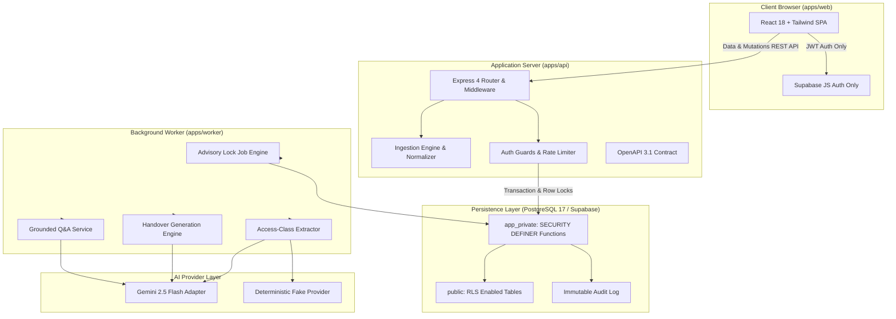
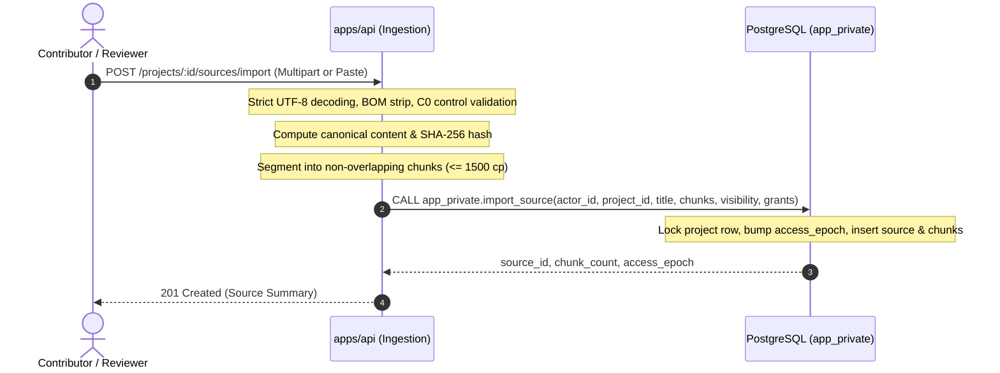
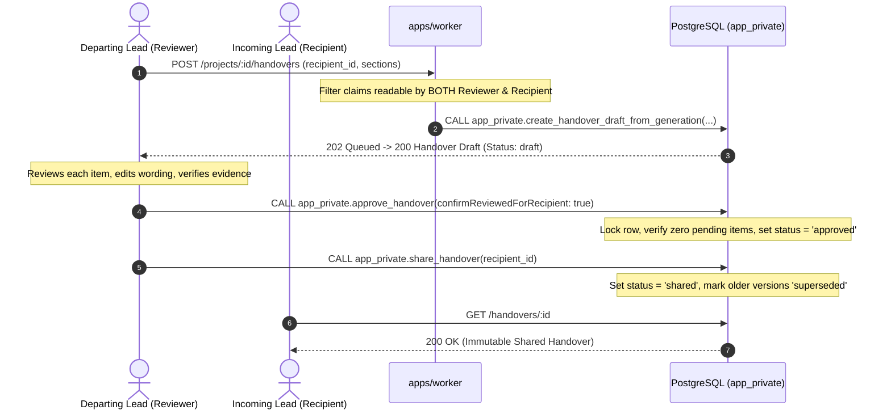
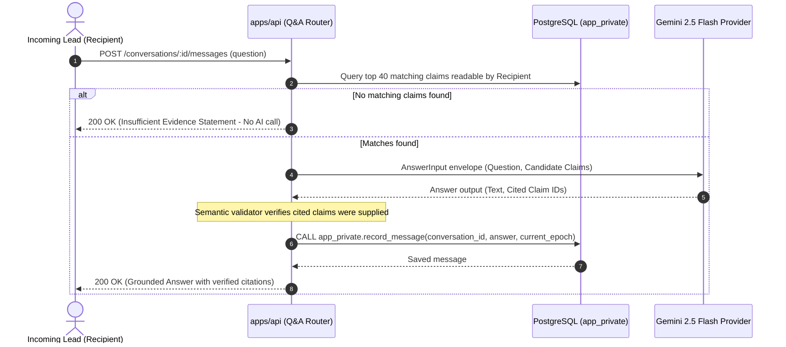

# Prasaranam Architecture and System Design

Relay is a production-grade, evidence-grounded, permission-aware knowledge handover system. It assists outgoing engineers and team leads in generating high-integrity handovers for incoming members while ensuring cryptographic provenance, strict tenant isolation, and zero unauthorized leakage of restricted material.



---

## 1. Monorepo Organization

The project is structured as an npm workspaces monorepo:

| Directory                | Role              | Description                                                                                                                                          |
| ------------------------ | ----------------- | ---------------------------------------------------------------------------------------------------------------------------------------------------- |
| `apps/api`               | Backend API       | Express HTTP service providing REST endpoints, authentication middleware, file ingestion, rate limiting, and mutation invocation.                    |
| `apps/web`               | Frontend SPA      | Vite + React application providing accessible UI components, source viewer, chunk highlighter, handover review studio, and Ask Relay Q&A.            |
| `apps/worker`            | Background Worker | Independent Node.js service leasing and executing asynchronous jobs (`extract`, `analyze_relationships`, `generate_handover`, `generate_questions`). |
| `packages/contracts`     | Shared Contracts  | Shared Zod schemas, TypeScript types, constants, and generated JSON Schema definitions.                                                              |
| `packages/database`      | Database Client   | Connection pooling, typed wrappers for `app_private` SQL functions, and transactional helpers.                                                       |
| `packages/test-fixtures` | Test Utilities    | Fixtures, test user factories, synthetic payment documents, and mocked test environments.                                                            |

---

## 2. Core Workflows & Sequence Diagrams

### 2.1 Ingestion Flow

Source text and structured files enter the system via `POST /api/v1/projects/:id/sources/import`.



### 2.2 Extraction & Access-Class Batching

Extraction jobs process sources strictly partitioned by access class `(visibility, set of granted user IDs)`.

```mermaid
sequenceDiagram
    autonumber
    participant Worker as apps/worker
    participant DB as PostgreSQL (app_private)
    participant AI as Gemini 2.5 Flash / Fake Provider

    Worker->>DB: CALL app_private.lease_job(worker_id)
    DB-->>Worker: job_data (kind: 'extract', access_class)
    Worker->>DB: Query unextracted chunks matching access_class
    DB-->>Worker: Chunks array
    Note over Worker: Construct ExtractionInput envelope with chunk IDs
    Worker->>AI: generateContent(ExtractionPrompt, Chunks)
    AI-->>Worker: Raw JSON output
    Note over Worker: Defensive parsing, Zod validation, Semantic validation
    Note over Worker: Verify quote substring match & code-point offsets
    Worker->>DB: CALL app_private.persist_claims(job_id, claims, access_epoch)
    Note over DB: Recheck project access_epoch; persist claims or STALE_CONTEXT
    DB-->>Worker: Success (persisted count)
```

### 2.3 Handover Generation, Review & Immutability



### 2.4 Evidence-Grounded Q&A (Ask Prasaranam)



---

## 3. Data Flow and Access Boundaries

1. **All Data Through API**: The web frontend communicates with Supabase strictly for session authentication (`auth.users`). Zero database table reads or writes occur from the browser directly.
2. **Access-Epoch Synchronization**: Any access change (member addition/removal, role change, source visibility change, or source archiving) atomically increments `public.projects.access_epoch`. Any generation, persistence, or Q&A operation citing a previous epoch is rejected with `STALE_CONTEXT`.
3. **Immutability Triggers**: Handover drafts that have been approved or shared cannot have their items, configuration, or citations altered. Subsequent edits require creating a new revision (`POST /handovers/:id/versions`).
