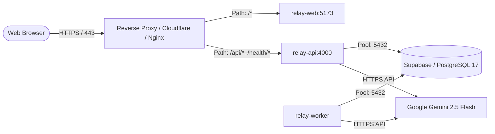

# Prasaranam Production Deployment Guide

This guide details the deployment of Relay across containerized environments, cloud providers, and managed Supabase infrastructure.

---

## 1. Architecture Overview

In production, Relay consists of three distinct service tiers:

1. **`web` (Frontend SPA)**: Unprivileged container serving compiled React assets on port 5173 (or behind a reverse proxy on 80/443).
2. **`api` (Backend REST API)**: Node.js Express server running on port 4000.
3. **`worker` (Background Job Engine)**: Autonomous Node.js process executing extraction, relationship analysis, and handover generation.
4. **Database (PostgreSQL 17 / Supabase)**: Managed database with Row Level Security, pgvector, and `app_private` schema.



---

## 2. Container Images & Docker Builds

The root `Dockerfile` produces lightweight, unprivileged production images using multi-stage builds:

### 2.1 Build Commands

```bash
# Build the API image
docker build --target api -t relay-api:v1.0.0 .

# Build the Background Worker image
docker build --target worker -t relay-worker:v1.0.0 .

# Build the Frontend Web image
docker build --target web -t relay-web:v1.0.0 .
```

### 2.2 Security Characteristics of Containers

- **Non-Root Execution**: All containers execute as the unprivileged `node` user (`UID 1000`).
- **Zero Dev Dependencies**: `npm prune --omit=dev` ensures test harnesses and build tools are excluded from production images.
- **Integrated Healthchecks**:
  - `api`: `node -e "fetch('http://localhost:4000/health/live')..."`
  - `web`: `node -e "fetch('http://localhost:5173/health/live')..."`

---

## 3. Docker Compose Orchestration

To run the complete production stack against a running database:

```bash
# Start all services in the background
docker compose up -d

# View service health and status
docker compose ps

# Inspect logs
docker compose logs -f api worker
```

---

## 4. Production Environment Configuration

Create a production `.env` file outside the source repository:

```ini
# Application Environment
NODE_ENV=production
PORT=4000
HOST=0.0.0.0

# CORS & Domain Settings
CORS_ORIGIN=https://app.relay.yourdomain.com

# PostgreSQL Connection
DATABASE_URL=postgresql://postgres:[PASSWORD]@[HOST]:[PORT]/postgres?sslmode=require

# Supabase Auth Configuration
SUPABASE_URL=https://[PROJECT_REF].supabase.co
SUPABASE_ANON_KEY=[YOUR_PRODUCTION_ANON_KEY]
SUPABASE_SERVICE_ROLE_KEY=[YOUR_PRODUCTION_SERVICE_ROLE_KEY]
SUPABASE_JWT_SECRET=[YOUR_SUPABASE_JWT_SECRET]

# AI Provider Configuration
AI_PROVIDER=gemini
GEMINI_API_KEY=[YOUR_GOOGLE_AI_STUDIO_API_KEY]
AI_MODEL_NAME=gemini-2.5-flash
AI_PROJECT_DAILY_TOKEN_BUDGET=1000000

# Worker Settings
WORKER_CONCURRENCY=4
WORKER_POLL_INTERVAL_MS=1500
```

> [!CAUTION]
> **Secret Protection**:
> Never commit `.env` or production credentials to git. The `scripts/scan-bundle.ts` scanner must run as part of CI before any release build is approved for deployment.

---

## 5. Reverse Proxy & SSL/TLS Configuration (Nginx Example)

```nginx
server {
    listen 443 ssl http2;
    server_name app.relay.yourdomain.com;

    ssl_certificate /etc/letsencrypt/live/relay/fullchain.pem;
    ssl_certificate_key /etc/letsencrypt/live/relay/privkey.pem;
    ssl_protocols TLSv1.2 TLSv1.3;
    ssl_ciphers HIGH:!aNULL:!MD5;

    # API and Health endpoints
    location /api/ {
        proxy_pass http://relay-api:4000;
        proxy_http_version 1.1;
        proxy_set_header Host $host;
        proxy_set_header X-Real-IP $remote_addr;
        proxy_set_header X-Forwarded-For $proxy_add_x_forwarded_for;
        proxy_set_header X-Forwarded-Proto https;
    }

    location /health/ {
        proxy_pass http://relay-api:4000;
        proxy_http_version 1.1;
    }

    # Static Web Application
    location / {
        proxy_pass http://relay-web:5173;
        proxy_http_version 1.1;
        proxy_set_header Host $host;
        proxy_set_header X-Forwarded-Proto https;
    }
}
```

---

## 6. Pre-Production Verification Checklist

Before opening Relay to internal or customer traffic:

1. [ ] **Database Migrations Applied**: Verify all migrations (1 to 24) are executed on the production database.
2. [ ] **Privilege Lockdown Intact**: Verify `REVOKE ALL ON public.* FROM anon, authenticated;` is active.
3. [ ] **Bundle Scan Clean**: Execute `npm run scan:bundle` against the build artifact.
4. [ ] **AI Provider Verified**: Confirm `GEMINI_API_KEY` has quota in Google AI Studio and network access to `generativelanguage.googleapis.com`.
5. [ ] **Health Probes Active**: Ensure load balancers hit `/health/live` and `/health/ready`.
